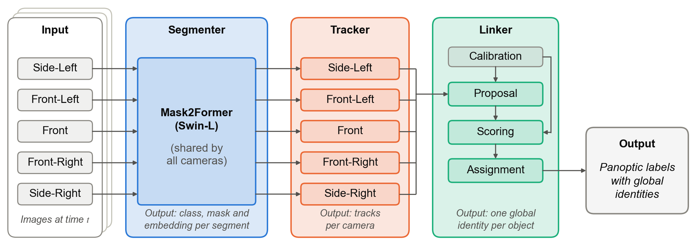
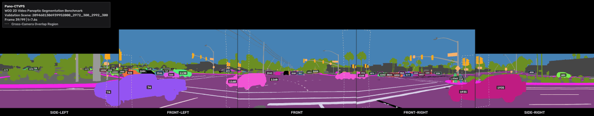

# Pano-CTVPS

**Panoramic video panoptic segmentation on the Waymo Open Dataset.** Pano-CTVPS labels every pixel of the
five cameras of the Waymo rig with a class and gives every object one identity that holds across the cameras
and over time. It has three parts:

- a **segmenter** (Mask2Former with a Swin-L backbone, one model shared by all cameras) that predicts the
  class, the mask and an embedding of every segment in each image;
- a **tracker** that follows the objects of each camera over time and outputs **tracks**;
- a **linker** that joins the tracks of adjacent cameras into **global identities**, using the camera
  calibration and the embeddings.



This repository holds the code of the article *Pano-CTVPS: Consistent Training for Panoramic Video Panoptic
Segmentation* (Türk, Erdinç and Danışman, Taner; IEEE Access, under review). It contains no Waymo data, no predictions,
no caches and no trained weights.

## Results

WOD 2D Video Panoptic Segmentation benchmark, test split, scored by the benchmark server
([leaderboard](https://waymo.com/open/challenges/2023/2d-video-panoptic-segmentation/)):

| Method | wSTQ | wAQ | wSQ (leaderboard: mIoU) |
|---|---|---|---|
| ViP-DeepLab baseline (Mei et al., 2022) | 0.1750 | 0.1062 | 0.2883 |
| **Pano-CTVPS** | **0.3187** | **0.1781** | **0.5702** |

Deployed settings. Tracker: θ_match 0.7, θ_init 0.01, N_dead 5 frames, motion gate 600 / 800 / 800 / 1000 /
1000 px (Front, Front-Left, Front-Right, Side-Left, Side-Right). Linker: `configs/linker_deployed.json`.



The preview shows the predicted panoptic labels of the five cameras in rig order, without the camera images. Every
object keeps one color and number across the cameras and over time. Dashed outlines mark the overlap regions of
adjacent cameras, computed from the calibration.

## Install

Python 3.10 or later and a CUDA GPU. Pure PyTorch: no custom CUDA extensions, no Detectron2. The exact versions
are pinned in [`requirements.txt`](requirements.txt) (Python 3.12, PyTorch 2.13.0 with CUDA 13.0,
Transformers 5.15.0, NumPy 2.5.2).

```bash
git clone https://github.com/erdincturk/pano-ctvps.git && cd pano-ctvps
python -m venv .venv && source .venv/bin/activate
pip install -r requirements.txt && pip install -e ".[dev]"
export TORCH_DISABLE_NATIVE_JIT=1   # PyTorch 2.13: skips a Triton JIT that needs python3-dev
pytest                              # unit tests, incl. an STQ check against the DeepLab2 reference
```

## Data

The code uses the [Waymo Open Dataset](https://waymo.com/open/) v2.0.1, which is not redistributed here. Register
on the Waymo Open Dataset website, accept its [terms of use](https://waymo.com/open/terms), and download the
`camera_image`, `camera_segmentation` and `camera_calibration` components of the training, validation and test
splits (for example with `gcloud storage cp`). The code expects them at `../data/waymo_open_dataset_v_2_0_1` or
at the path given with `--dataset-root`. The scene lists are the 696 / 20 / 40 scenes of the benchmark, in
`configs/splits/`. Check the download with `python scripts/verify_dataset.py --data-root <root>`.

This software was made using the Waymo Open Dataset, provided by Waymo LLC under the Waymo Dataset License
Agreement for Non-Commercial Use, available at [waymo.com/open/terms](https://waymo.com/open/terms), and your
access and use of such work are governed by the terms and conditions therein.

## Run the pipeline

Checkpoints are read from `checkpoints/`, results are written to `outputs/`. Every script documents its options
with `--help`. Evaluation is at native resolution, zero-padded to a multiple of 32.

```bash
# 1. Segmenter, panoptic fine-tuning: 20,000 iterations on the Front camera, then 80,000 on all cameras
python scripts/train_segmenter.py --config configs/training/segmenter_mapillary_refined_front.yaml
python scripts/train_segmenter.py --config configs/training/segmenter_mapillary_refined.yaml \
    --resume-from outputs/segmenter_mapillary_refined_front/best.pth
python scripts/eval_segmenter.py --config configs/training/segmenter_mapillary_refined.yaml \
    --checkpoint checkpoints/segmenter.pth                      # Table 5

# 2. Identity training of the decoder and the embedding head
python scripts/train_tracker.py --config configs/training/tracker_ctvis.yaml

# 3. Segmenter outputs, computed once and cached (validation and training with ground-truth ids; test without)
python scripts/build_cache_gt.py --checkpoint checkpoints/tracker.pth --split validation \
    --cache-dir outputs/tracker_ctvis_val_cache
python scripts/build_cache_gt.py --checkpoint checkpoints/tracker.pth --split training \
    --cache-dir outputs/tracker_ctvis_train_cache
python scripts/build_cache.py --checkpoint checkpoints/tracker.pth --split test \
    --cache-dir outputs/tracker_ctvis_test_cache

# 4. Tracker at the deployed settings (CPU, from the cache); its tracks are written into the cache
python scripts/eval_tracker_cached.py --cache-dir outputs/tracker_ctvis_val_cache --tracker memorybank \
    --match-threshold 0.7 --init-score-threshold 0.01 --num-dead-frames 5 \
    --motion-gate --motion-gate-px-per-cam "1:600,2:800,3:800,4:1000,5:1000" \
    --save-trajectories outputs/tracker/val_tracks.npz --output outputs/tracker/val.json
python scripts/build_cache_trackids.py --cache-dir outputs/tracker_ctvis_val_cache \
    --trajectories outputs/tracker/val_tracks.npz --write
#    the same two commands for the training cache, and for the test cache with --no-eval

# 5. Linker: adapter, candidate scores, adapted cosines, evaluation
python scripts/build_pairs.py --cache-dir outputs/tracker_ctvis_train_cache --out-dir outputs/linker/pairs_train
python scripts/train_adapter.py --pairs-dir outputs/linker/pairs_train --cache-dir outputs/tracker_ctvis_train_cache \
    --out-dir outputs/linker
python scripts/build_scores.py --cache-dir outputs/tracker_ctvis_val_cache --out-dir outputs/linker/scored_candidates
python scripts/build_cosines.py --adapter outputs/linker/adapter.pt --cache-dir outputs/tracker_ctvis_val_cache \
    --scores-dir outputs/linker/scored_candidates --out-dir outputs/linker/adapted_cosines
python scripts/eval_linker_wstq.py --cache-dir outputs/tracker_ctvis_val_cache \
    --cosines-dir outputs/linker/adapted_cosines --configs configs/linker_deployed.json \
    --output outputs/linker/deployed.json

# 6. Benchmark submission (test split)
python scripts/build_scores.py --cache-dir outputs/tracker_ctvis_test_cache --out-dir outputs/linker/scored_candidates_test
python scripts/build_cosines.py --adapter outputs/linker/adapter.pt --cache-dir outputs/tracker_ctvis_test_cache \
    --scores-dir outputs/linker/scored_candidates_test --out-dir outputs/linker/adapted_cosines_test
python scripts/build_submission.py --split test --account <registered e-mail> \
    --cache-dir outputs/tracker_ctvis_test_cache --cosines-dir outputs/linker/adapted_cosines_test
python scripts/package_submission.py --split test
```

## Reproduce the experiments of the paper

All steps after the cache run on the CPU and are deterministic given the cache. Each tracker evaluation needs
about 18 GB of memory; `--workers` sets how many run in parallel.

| Experiment | Command |
|---|---|
| Segmenter (Table 5) | steps 1 and 3 above |
| Our tracker: published and retuned thresholds (Table 6, Table S3) | `python scripts/sweep_tracker.py --grid thresholds` |
| Motion gate (Table 6, Table S4) | `python scripts/sweep_tracker.py --grid gate`, then `--grid deployed`; `python scripts/sweep_tracker.py --summary` prints Tables S3 and S4 |
| IoU tracker and MinVIS (Table 6, Tables S1 and S2) | `python scripts/sweep_baselines.py`, then `python scripts/baseline_tables.py` |
| Linker steps, wSTQ and wAQ (Table 7) | `python scripts/eval_linker_wstq.py --cache-dir outputs/tracker_ctvis_val_cache --cosines-dir outputs/linker/adapted_cosines --configs configs/linker_table7.json --output outputs/linker/table7.json` |
| Linker steps, precision and recall (Table 7), links per camera pair (Table S5) | `python scripts/eval_linker_links.py --scores-dir outputs/linker/scored_candidates --cosines-dir outputs/linker/adapted_cosines --configs configs/linker_table7.json --output outputs/linker/table7_links.json` |
| Per-scene scores (Table S7) and the Wilcoxon test (Section VI-A) | `per_scene` in `outputs/linker/table7.json`; `python scripts/analyze_significance.py --wstq-json outputs/linker/table7.json --config appearance_veto` |
| Causal linker (Section VI-C, Table S6) | `python scripts/run_online_linker.py --stage build --workers 8`, then `--stage sweep`; writes `outputs/online_linker/REPORT.md` |
| Runtime (Section VI-C) | segmenter: `python scripts/time_segmenter.py --checkpoint <ckpt>` and, five images per frame in batches, `python scripts/time_segmenter_batched.py --checkpoint <ckpt>`; tracker: `python scripts/time_tracker.py`; linker: timing section of the causal-linker report |
| Test submission (Table 4) | step 6 above |

## Citation

If you use this code, please cite the article and the dataset:

```bibtex
@article{turk2026panoctvps,
  author  = {Türk, Erdinç and Danışman, Taner},
  title   = {{Pano-CTVPS}: Consistent Training for Panoramic Video Panoptic Segmentation},
  journal = {IEEE Access},
  year    = {2026},
  note    = {under review}
}

@misc{waymo_open_dataset,
  title   = {Waymo Open Dataset: An autonomous driving dataset},
  website = {\url{https://www.waymo.com/open}},
  year    = {2019-2025}
}

@inproceedings{sun2020scalability,
  author    = {Sun, Pei and Kretzschmar, Henrik and Dotiwalla, Xerxes and Chouard, Aurelien and Patnaik, Vijaysai
               and Tsui, Paul and Guo, James and Zhou, Yin and Chai, Yuning and Caine, Benjamin and others},
  title     = {Scalability in Perception for Autonomous Driving: {Waymo} Open Dataset},
  booktitle = {Proc. IEEE/CVF Conf. Computer Vision and Pattern Recognition (CVPR)},
  year      = {2020}
}

@inproceedings{mei2022waymo,
  author    = {Mei, Jieru and Zhu, Alex Zihao and Yan, Xinchen and Yan, Hang and Qiao, Siyuan and Chen, Liang-Chieh
               and Kretzschmar, Henrik},
  title     = {{Waymo} Open Dataset: Panoramic Video Panoptic Segmentation},
  booktitle = {Proc. European Conf. Computer Vision (ECCV)},
  year      = {2022}
}
```

## Acknowledgment

This work was supported by the Scientific and Technological Research Council of Türkiye (TÜBİTAK) under Grant
225E028.

## License

The code is released under the Apache License 2.0 ([LICENSE](LICENSE)). The Waymo Open Dataset is not part of
this repository and is subject to its own [terms of use](https://waymo.com/open/terms).
