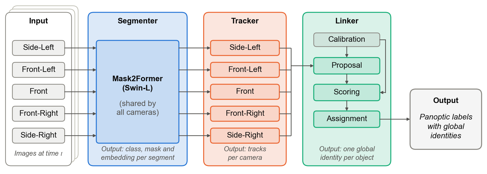
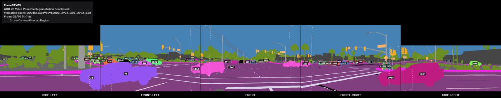

# Pano-CTVPS

**Panoramic video panoptic segmentation on the Waymo Open Dataset.** Pano-CTVPS labels every pixel of the
five cameras of the Waymo rig with a class and gives every object one identity that holds across the cameras
and over time. It has three parts:

- a **segmenter** (Mask2Former with a Swin-L backbone, one model shared by all cameras) that predicts the
  class, the mask and an embedding of every segment in each image;
- a **tracker** that follows the objects of each camera over time and outputs **tracks**;
- a **linker** that joins the tracks of adjacent cameras into **global identities**, using the camera
  calibration and the embeddings.



This repository holds the code of the article *Pano-CTVPS: A Three-Stage Pipeline for Panoramic Video Panoptic
Segmentation* (Türk, Erdinç and Danışman, Taner; IEEE Access, under review). It contains no Waymo data, no predictions,
no caches and no trained weights. The cached outputs of the deployed system, the linker adapter and the scored
benchmark submissions will be published on Zenodo after acceptance.

## Results

WOD 2D Video Panoptic Segmentation benchmark, test split, scored by the benchmark server
([leaderboard](https://waymo.com/open/challenges/2023/2d-video-panoptic-segmentation/)):

| Method | wSTQ | wAQ | wSQ (leaderboard: mIoU) |
|---|---|---|---|
| ViP-DeepLab baseline (Mei et al., 2022) | 0.1750 | 0.1062 | 0.2883 |
| **Pano-CTVPS** | **0.3187** | **0.1781** | **0.5702** |

Validation split (20 scenes), scored with the evaluator of this repository; a re-run of the pipeline below can be
checked against these values:

| Stage | Metric | Value | Paper |
|---|---|---|---|
| Segmenter | PQ (all / thing / stuff classes) | 0.4695 / 0.3642 / 0.5116 | Table 5 |
| Segmenter + tracker | wSTQ / wAQ / wSQ | 0.3149 / 0.1652 / 0.6003 | Table 6, row 11 |
| Full system (segmenter + tracker + linker) | wSTQ / wAQ / wSQ | 0.3228 / 0.1736 / 0.6003 | Table 7 |

The deployed system uses, in the tracker, θ_match 0.7, θ_init 0.01, N_dead 5 frames and the motion gate bounds
600 / 800 / 800 / 1000 / 1000 px (Front, Front-Left, Front-Right, Side-Left, Side-Right), and, in the linker,
`configs/linker/deployed.json`.



The preview shows the predicted panoptic labels of the five cameras in rig order, without the camera images. Every
object keeps one color and number across the cameras and over time. Dashed outlines mark the overlap regions of
adjacent cameras, computed from the calibration.

## Install

Python 3.10 or later and a CUDA GPU. Pure PyTorch: no custom CUDA extensions, no Detectron2. The exact versions
are pinned in [`requirements.txt`](requirements.txt) (Python 3.12, PyTorch 2.13.0 with CUDA 13.0,
Transformers 5.15.0, NumPy 2.5.2). Tested on an NVIDIA DGX Spark (GB10 GPU, 128 GB unified memory, ARM64).

```bash
git clone https://github.com/erdincturk/pano-ctvps.git && cd pano-ctvps
python -m venv .venv && source .venv/bin/activate
pip install -r requirements.txt && pip install -e ".[dev]"
export TORCH_DISABLE_NATIVE_JIT=1   # PyTorch 2.13: skips a Triton JIT that needs python3-dev
pytest                              # unit tests, incl. an STQ check against the DeepLab2 reference
```

## Data

The code uses the [Waymo Open Dataset](https://waymo.com/open/) v2.0.1, which is not redistributed here. Register
on the Waymo Open Dataset website, accept its [terms of use](https://waymo.com/open/terms), and download the
`camera_image`, `camera_segmentation` and `camera_calibration` components of the training, validation and test
splits (for example with `gcloud storage cp`). The code expects them at `../data/waymo_open_dataset_v_2_0_1` or
at the path given with `--dataset-root`. The scene lists are the 696 / 20 / 40 scenes of the benchmark, in
`configs/splits/`. Check the download with `python scripts/pipeline/verify_dataset.py --data-root <root>`.

This software was made using the Waymo Open Dataset, provided by Waymo LLC under the Waymo Dataset License
Agreement for Non-Commercial Use, available at [waymo.com/open/terms](https://waymo.com/open/terms), and your
access and use of such work are governed by the terms and conditions therein.

## Repository layout

```
panoctvps/               the package: data loading, segmenter, tracker, linker, evaluation (STQ, PQ), submission
scripts/pipeline/        train, cache, track, link and submit: the deployed system (steps 1 to 6 below)
scripts/experiments/     the experiments of the paper: tracker cells, held-out check, linker evaluations,
                         causal linker, runtime
scripts/analysis/        the analyses of the paper: dataset statistics, failure modes, tracker and linker analyses
configs/data/, models/   dataset and model settings shared by the training configurations
configs/training/        segmenter and identity training (segmenter_cityscapes.yaml and segmenter_mapillary.yaml:
                         the comparison of the two initializations, Section V-B)
configs/tracker_cells/   the tracker settings of Table 6 and Tables S9 to S14
configs/splits/          the annotated frames of the training, validation and test scenes
configs/linker/          the deployed linker (deployed.json) and the steps of Table 7 (table7.json)
tests/                   unit tests (pytest), one folder per package part
```

## Run the pipeline

Checkpoints are read from `checkpoints/`, results are written to `outputs/`. Every script documents its options
with `--help`. Evaluation is at native resolution, zero-padded to a multiple of 32.

```bash
# 1. Segmenter, panoptic fine-tuning: 20,000 iterations on the Front camera, then 80,000 on all cameras
python scripts/pipeline/train_segmenter.py --config configs/training/segmenter_mapillary_refined_front.yaml
python scripts/pipeline/train_segmenter.py --config configs/training/segmenter_mapillary_refined.yaml \
    --resume-from outputs/segmenter_mapillary_refined_front/best.pth
mkdir -p checkpoints && cp outputs/segmenter_mapillary_refined/ckpt_0080000.pth checkpoints/segmenter.pth  # last iteration, not best.pth
python scripts/pipeline/eval_segmenter.py --config configs/training/segmenter_mapillary_refined.yaml \
    --checkpoint checkpoints/segmenter.pth                      # Table 5

# 2. Identity training of the decoder and the embedding head (starts from checkpoints/segmenter.pth)
python scripts/pipeline/train_tracker.py --config configs/training/tracker_ctvis.yaml
cp outputs/tracker_ctvis/<identity-training checkpoint>.pth checkpoints/tracker.pth

# 3. Segmenter outputs, computed once and cached (validation and training with ground-truth ids; test without)
python scripts/pipeline/build_cache_gt.py --checkpoint checkpoints/tracker.pth --split validation \
    --cache-dir outputs/tracker_ctvis_val_cache
python scripts/pipeline/build_cache_gt.py --checkpoint checkpoints/tracker.pth --split training \
    --cache-dir outputs/tracker_ctvis_train_cache
python scripts/pipeline/build_cache.py --checkpoint checkpoints/tracker.pth --split test \
    --cache-dir outputs/tracker_ctvis_test_cache

# 4. Tracker at the deployed settings (CPU, from the cache); its tracks are written into the cache
python scripts/pipeline/eval_tracker_cached.py --cache-dir outputs/tracker_ctvis_val_cache --tracker memorybank \
    --match-threshold 0.7 --init-score-threshold 0.01 --num-dead-frames 5 \
    --motion-gate --motion-gate-px-per-cam "1:600,2:800,3:800,4:1000,5:1000" \
    --save-trajectories outputs/tracker/val_tracks.npz --output outputs/tracker/val.json
python scripts/pipeline/build_cache_trackids.py --cache-dir outputs/tracker_ctvis_val_cache \
    --trajectories outputs/tracker/val_tracks.npz --write
#    the same two commands for the training cache, and for the test cache with --no-eval

# 5. Linker: adapter, candidate scores, adapted cosines, evaluation
python scripts/pipeline/build_pairs.py --cache-dir outputs/tracker_ctvis_train_cache --out-dir outputs/linker/pairs_train
python scripts/pipeline/train_adapter.py --pairs-dir outputs/linker/pairs_train --cache-dir outputs/tracker_ctvis_train_cache \
    --out-dir outputs/linker
python scripts/pipeline/build_scores.py --cache-dir outputs/tracker_ctvis_val_cache --out-dir outputs/linker/scored_candidates
python scripts/pipeline/build_cosines.py --adapter outputs/linker/adapter.pt --cache-dir outputs/tracker_ctvis_val_cache \
    --scores-dir outputs/linker/scored_candidates --out-dir outputs/linker/adapted_cosines
python scripts/pipeline/eval_linker_wstq.py --cache-dir outputs/tracker_ctvis_val_cache \
    --cosines-dir outputs/linker/adapted_cosines --configs configs/linker/deployed.json \
    --output outputs/linker/deployed.json

# 6. Benchmark submission (test split)
python scripts/pipeline/build_scores.py --cache-dir outputs/tracker_ctvis_test_cache --out-dir outputs/linker/scored_candidates_test
python scripts/pipeline/build_cosines.py --adapter outputs/linker/adapter.pt --cache-dir outputs/tracker_ctvis_test_cache \
    --scores-dir outputs/linker/scored_candidates_test --out-dir outputs/linker/adapted_cosines_test
python scripts/pipeline/build_submission.py --split test --account <registered e-mail> \
    --cache-dir outputs/tracker_ctvis_test_cache --cosines-dir outputs/linker/adapted_cosines_test
python scripts/pipeline/package_submission.py --split test
python scripts/pipeline/verify_submission.py --split test     # with --split validation: recomputes wSTQ 0.3228
```

## Reproduce the experiments of the paper

All steps after the caches run on the CPU and are deterministic given the caches. Each tracker evaluation needs
about 18 GB of memory; `--workers` sets how many scenes run in parallel. Every script in `scripts/experiments/` and
`scripts/analysis/` names, at the top of its file, the tables of the paper it produces and gives its full command.

### Caches and overlap tables

Table 6 compares three models, each with its own validation cache: the deployed model (step 3 above), the segmenter
before identity training, and the identity training in which every positive is the raw embedding of its reference
frame (p = 0, Section IV-B1).

```bash
# segmenter before identity training: its weights with an unused embedding head
python scripts/experiments/build_segmenter_checkpoint.py --segmenter checkpoints/segmenter.pth \
    --output checkpoints/segmenter_for_cache.pth
python scripts/pipeline/build_cache_gt.py --checkpoint checkpoints/segmenter_for_cache.pth --split validation \
    --cache-dir outputs/segmenter_val_cache
# identity training with p = 0
python scripts/pipeline/train_tracker.py --config configs/training/tracker_ctvis_p0.yaml
python scripts/pipeline/build_cache_gt.py --checkpoint checkpoints/tracker_ctvis_p0.pth --split validation \
    --cache-dir outputs/tracker_ctvis_p0_val_cache
# overlap tables, one folder per cache (likewise segmenter_val and tracker_ctvis_p0_val)
python scripts/experiments/build_overlap_tables.py --cache-dir outputs/tracker_ctvis_val_cache \
    --out-dir outputs/overlap_tables/tracker_ctvis_val
```

The trackers and the linker change only identities, never masks or classes, so every tracker and linker run below
is scored exactly from the overlap tables of its cache, with the same scores as `scripts/pipeline/eval_tracker_cached.py`
and `scripts/pipeline/eval_linker_wstq.py`.

**Rule of the evaluator.** When a camera frame has no ground-truth pixel of a thing class, `STQuality.update`
returns before it adds the predicted instances of that frame (`panoctvps/evaluation/stq.py`), so predicted thing
masks in such frames are skipped and do not lower AQ. Every validation score of the paper is computed this way, and
the overlap tables follow the same rule. Without it, 12 of the 20 validation scenes would differ by up to 0.0005 in
wAQ. The test score is computed by the benchmark server and is not affected.

### Tracker cells

A cell is one tracker at one setting on one cache (`configs/tracker_cells/`). Run them per cache; the gate sweeps
go to a folder of their own, so that the held-out check (`scripts/experiments/eval_heldout.py`, Table S13) can
select the grids by file name.

```bash
C=tracker_ctvis_val      # also segmenter_val (baselines_grid only) and tracker_ctvis_p0_val (baselines_grid, ctvis_grid)
for g in baselines_grid ctvis_grid full_tracker tracker_components; do
  python scripts/experiments/run_tracker_cells.py --cache-dir outputs/${C}_cache --tables-dir outputs/overlap_tables/$C \
      --cells configs/tracker_cells/$g.json --out-dir outputs/tracker_cells/$C
done
for m in 0.60 0.70; do   # deployed model only
  python scripts/experiments/run_tracker_cells.py --cache-dir outputs/${C}_cache --tables-dir outputs/overlap_tables/$C \
      --cells configs/tracker_cells/gate_sweep_m$m.json --out-dir outputs/tracker_cells/${C}_gate
done
```

Long runs can be split by scene (`--scenes`, one folder per scene) and merged with `scripts/experiments/merge_tracker_cells.py`.

## Citation

If you use this code, please cite the article and the dataset:

```bibtex
@article{turk2026panoctvps,
  author  = {Türk, Erdinç and Danışman, Taner},
  title   = {{Pano-CTVPS}: A Three-Stage Pipeline for Panoramic Video Panoptic Segmentation},
  journal = {IEEE Access},
  year    = {2026},
  note    = {under review}
}

@misc{waymo_open_dataset,
  title   = {Waymo Open Dataset: An autonomous driving dataset},
  website = {\url{https://www.waymo.com/open}},
  year    = {2019-2025}
}

@inproceedings{sun2020scalability,
  author    = {Sun, Pei and Kretzschmar, Henrik and Dotiwalla, Xerxes and Chouard, Aurelien and Patnaik, Vijaysai
               and Tsui, Paul and Guo, James and Zhou, Yin and Chai, Yuning and Caine, Benjamin and others},
  title     = {Scalability in Perception for Autonomous Driving: {Waymo} Open Dataset},
  booktitle = {Proc. IEEE/CVF Conf. Computer Vision and Pattern Recognition (CVPR)},
  year      = {2020}
}

@inproceedings{mei2022waymo,
  author    = {Mei, Jieru and Zhu, Alex Zihao and Yan, Xinchen and Yan, Hang and Qiao, Siyuan and Chen, Liang-Chieh
               and Kretzschmar, Henrik},
  title     = {{Waymo} Open Dataset: Panoramic Video Panoptic Segmentation},
  booktitle = {Proc. European Conf. Computer Vision (ECCV)},
  year      = {2022}
}
```

## Acknowledgment

This work was supported by the Scientific and Technological Research Council of Türkiye (TÜBİTAK) under Grant
225E028.

## License

The code is released under the Apache License 2.0 ([LICENSE](LICENSE)). The Waymo Open Dataset is not part of
this repository and is subject to its own [terms of use](https://waymo.com/open/terms).
